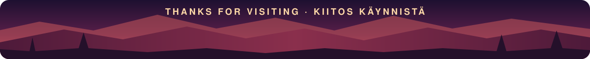

  

  

  
  
  
  
  

---

## 🌄 About me

<table>
<tr>
<td width="50%" valign="top">

**⚡ Right now**

- 🏢 Building products under my own company **Havaida Oy**
- 🎓 Studying ICT at **JAMK University of Applied Sciences**
- 🧩 Solving LeetCode & Codeforces problems — and writing up what I learn
- 🔍 **Open to new roles** — dev, support & ops, Jyväskylä / remote / hybrid

</td>
<td width="50%" valign="top">

**🧭 Background**

- 💡 **C2 SmartLight** · Developer & Technical Expert · 2024–2026 Smart lighting control systems, installer mobile app, React map view
- ☁️ **Topteam IT** · System Specialist · 2021–2024 Azure & Microsoft 365, security monitoring, backups
- 🎮 Made my first game at 13 in GameMaker

</td>
</tr>
</table>

---

## 🚀 Featured work

<table>
<tr>
<td width="33%" valign="top">

### 📦 WareTrack
Warehouse management system with a live **3D warehouse view** — stock, locations and picking in one place.

`React` `Three.js` `Supabase`

[**▸ laikku.dev**](https://laikku.dev)

</td>
<td width="33%" valign="top">

### 🌍 Havaida Worlds
Interactive **3D worlds** in the browser — incl. an IoT smart city with sensors, device management and live data.

`Three.js` `React` `IoT`

[**▸ laikku.dev/worlds**](https://laikku.dev/worlds/)

</td>
<td width="33%" valign="top">

### 🏙️ Kerros
Housing company dashboard with a **3D apartment building** generated from OpenStreetMap data.

`React` `Three.js` `OSM`

[**▸ laikku.dev**](https://laikku.dev)

</td>
</tr>
<tr>
<td width="33%" valign="top">

### 🕹️ Havaida Games
Six company-themed browser mini-games built as a playable portfolio.

`TypeScript` `Canvas`

[**▸ laikku-games**](https://github.com/ClauterL/laikku-games)

</td>
<td width="33%" valign="top">

### 🧠 LeetCode
My LeetCode solutions in TypeScript — with tests and a learning journal.

`TypeScript` `Algorithms`

[**▸ leetcode**](https://github.com/ClauterL/leetcode)

</td>
<td width="33%" valign="top">

### 🌅 Laikku.com
My personal portfolio — a normal site and a gamified 3D loft version.

`React` `Vite` `Tailwind`

[**▸ laikku.com**](https://laikku.com)

</td>
</tr>
</table>

---

## 🛠️ Tech stack

   
   
  

---

## 📊 Languages

  

  

