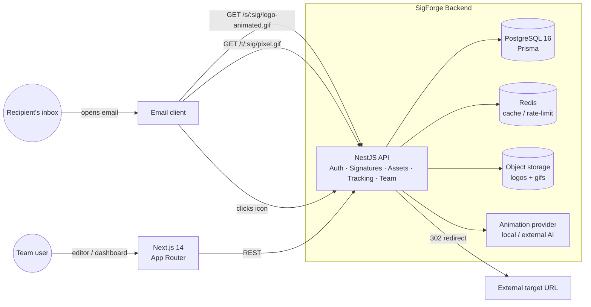

# SigForge

Multi-tenant SaaS for creating professional email signatures with an animated logo and
an interactive icon bar. The animations are **not embedded in the email** — they are
served from our own backend as lightweight `image/gif` resources, so deliverability
stays intact and every impression and click is tracked per signature.

## Why server-hosted animations?

Every major email client (Gmail, Outlook desktop, iOS Mail, Yahoo, Apple Mail…)
strips or refuses:

- `<script>` tags
- CSS animations (`@keyframes`, `transition`)
- external `<link rel="stylesheet">`
- inline SVG animation (`<animate>` sometimes works, but is unreliable)

Sending large embedded animated GIFs bloats the message and hurts inbox placement.
The industry-safe path is:

1. Store the animation as a static asset on **our** infrastructure.
2. Put a `<table>`-based, inline-styled signature in the email HTML.
3. Reference our asset URLs (`/s/:signatureId/:asset`) from `` tags.
4. Use a tracking pixel (`/t/:signatureId/pixel.gif`) for impressions.
5. Route every clickable icon through `/r/:linkId` for click attribution.

The signature HTML is generated by the API, capped at **15 KB**, contains no
JavaScript, no `<style>` blocks, and no external CSS. See the tests in
`apps/api/src/signature/signature-html.generator.spec.ts`.

## Architecture



## Repo layout

```
sigforge/
├── apps/
│   ├── api/                 NestJS + Prisma + Redis
│   └── web/                 Next.js 14 (App Router) + Tailwind
├── packages/
│   └── shared/              Zod schemas (auth, org, signature)
├── docker-compose.yml
├── .env.example
└── turbo.json
```

## Local setup

Prerequisites: **Node 20.11+**, **pnpm 9+**, **Docker**.

```bash
cp .env.example .env
pnpm install

# Start Postgres + Redis
pnpm docker:up postgres redis

# Migrate the DB
pnpm --filter @sigforge/api prisma migrate dev --name init
pnpm db:seed

# Run everything (API + Web) with hot-reload
pnpm dev
```

- API: <http://localhost:4000>
- Web: <http://localhost:3000>
- Demo login: `demo@sigforge.dev` / `demo-password`

### Full docker-compose (API + Web too)

```bash
pnpm docker:up
```

## Tests

```bash
pnpm --filter @sigforge/api test
```

Two suites in particular guard the MVP contract:

- `signature-html.generator.spec.ts` — asserts the emitted HTML is < 15 KB, contains
  no `<script>`, no `<style>`, no `class="…"`, uses `<table>` layout with inline
  `style=` attributes, and points at our tracked link and pixel URLs.
- `tracking.service.spec.ts` — asserts the 1×1 pixel is a real GIF89a, impressions
  and clicks are recorded with a **hashed** IP (SHA-256) and truncated UA, and the
  30-day chart returns 30 buckets.

## Data model

`Org`, `User`, `Membership(role)`, `Signature`, `SignatureAsset`, `TrackedLink`,
`ImpressionEvent`, `ClickEvent`.

- Every service call filters by `orgId` from the JWT (`RequestUser.orgId`) — RLS is
  enforced at the service layer, not at the DB.
- `ImpressionEvent` and `ClickEvent` are indexed on `(signatureId, createdAt)` for
  the 30-day chart. Monthly partitioning is a follow-up.

## Animation provider abstraction

`AnimationProvider` (`apps/api/src/animation/animation-provider.interface.ts`) has
two adapters:

- `LocalGifProvider` — uses `sharp` + `gifenc` to produce a `fade-loop` or `pulse`
  GIF from the user's static PNG. Used by default (`ANIMATION_PROVIDER=local`).
- `ExternalAiProvider` — placeholder stub. Wire this up when picking an external
  animation vendor; nothing else in the codebase changes.

## Non-goals for this MVP

Stripe billing, real SMTP invites, browser extension, admin panel, AI animation.
Extension points are marked with `TODO`.

## Contributing

Conventional commits, TypeScript strict, zod on every API input. Please add a test
whenever you touch `signature-html.generator.ts` or `tracking.service.ts`.
